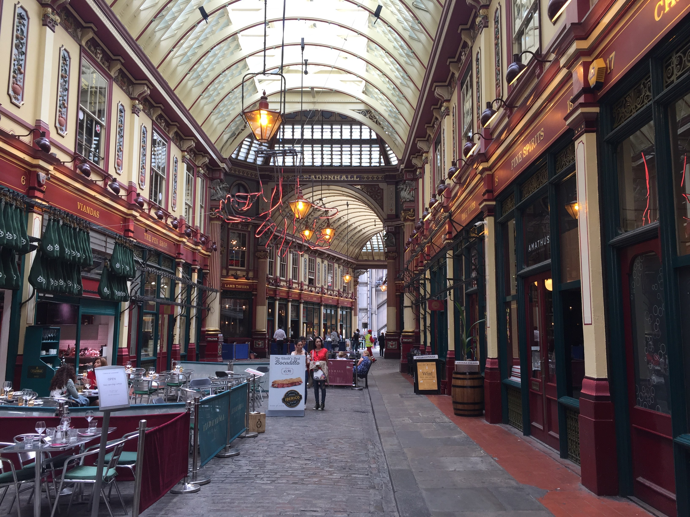
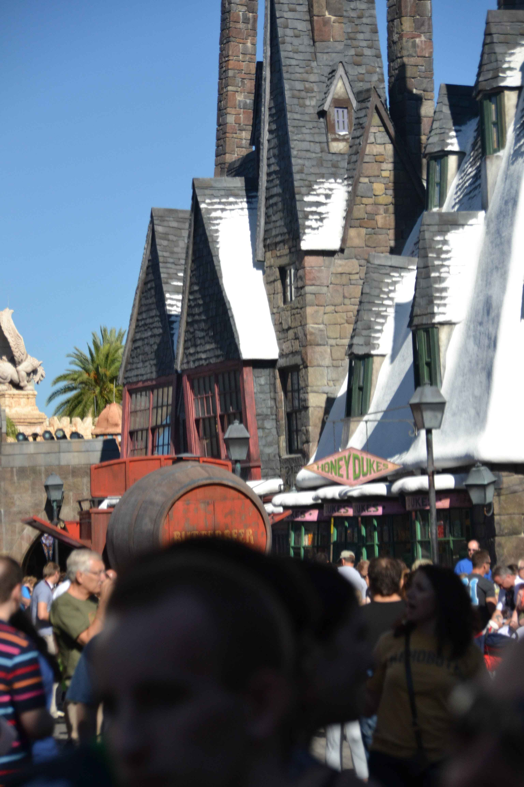
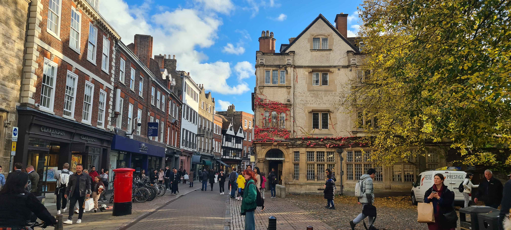
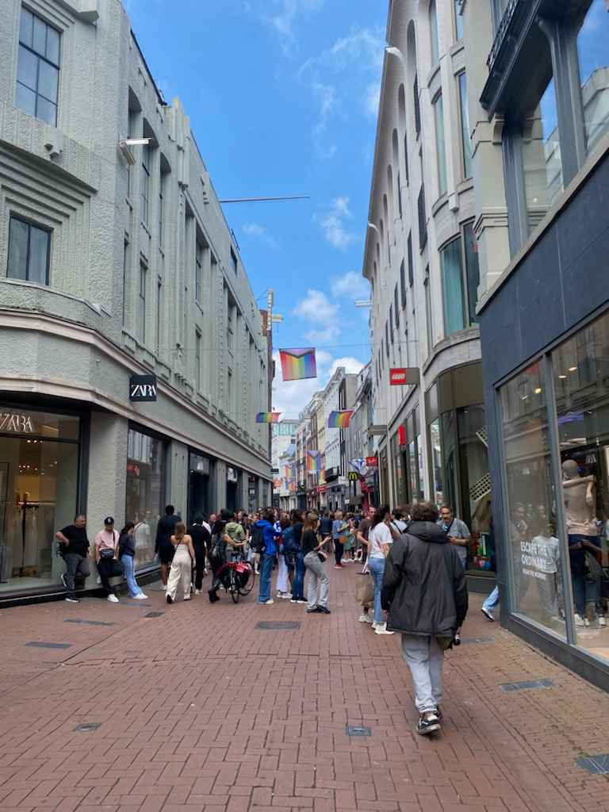
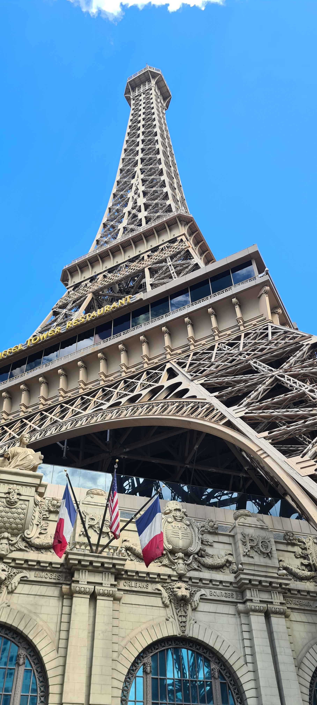
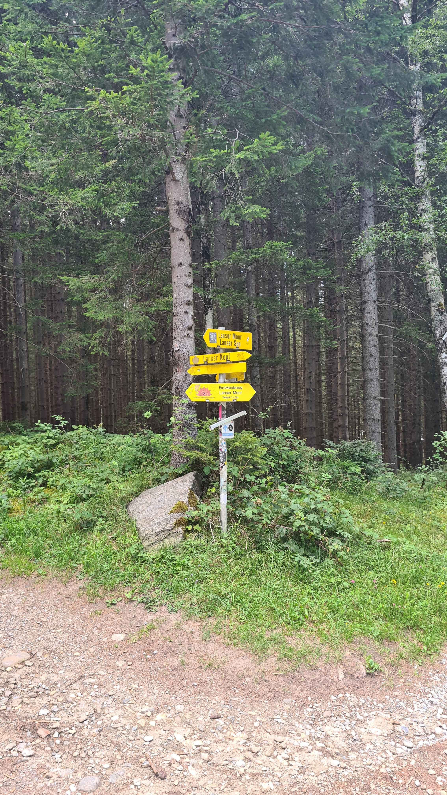
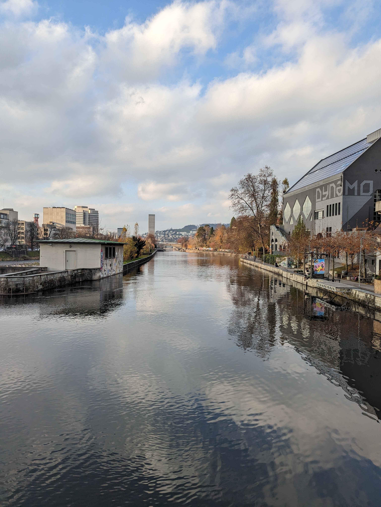
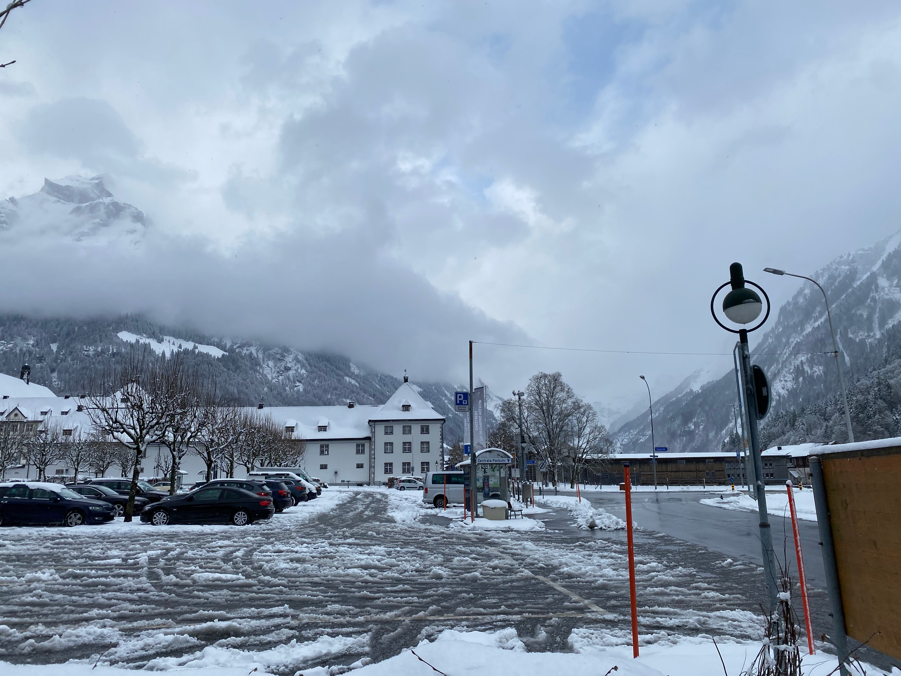

#### Uppdrag
## Semesterbilder

Du blinkar till. Skärmarna flimrar framför dig, larmen piper i bakgrunden och
någon ropar något om ”Zero-Trust”. Mitt i allt incidentkaos drömmer du dig bort
ett ögonblick, eller kanske svimmade du till en sekund?

När du kommer till dig igen känns allting märkligt avlägset.

Du försöker minnas var du varit… men huvudet är tomt.

```
Flaggan är den första bokstaven i namnet på alla städer i ordningen bilderna ligger, omgivet av OP{...}. T.ex om första bilden var tagen i Oslo, nästa i Stockholm och tredje i Tokyo så skulle flaggan vara OP{OST}.
```










---
### Solution

| City                | Coordinates                             | Image file                |
|---------------------|-----------------------------------------|---------------------------|
| LONDON              | 51.51284462160196, -0.08374522979707406 | 1774306451938-osint-1.jpg |
| LOS ANGELES$^{[1]}$ | 34.1387100334703, -118.35424165622234   | 1774306478629-osint-2.jpg |
| CAMBRIDGE           | 52.207288195190536, 0.11802488444394378 | 1774306499724-osint-3.jpg |
| AMSTERDAM           | 52.37076106751089, 4.891727701233192    | 1774306523239-osint-4.jpg |
| LAS VEGAS           | 36.11257763572177, -115.17251087727368  | 1774306543343-osint-5.jpg |
| INNSBRUCK           |                                         | 1774306566038-osint-6.jpg |
| ZURICH              | 47.38265874447081, 8.539813074700039    | 1774306598860-osint-7.jpg |
| ENGELBERG           | 46.820301609638044, 8.406445920731125   | 1774306623389-osint-8.jpg |

[1]. The location the image was taken in was identified as "Los Angeles", with
the associated coordinates, but deducting from the formed string (concatenating
the first letter of each city) it was assumed that the intended city was "
Orlando" (other Disneyland location).

Flag: `OP{LOCALIZE}`