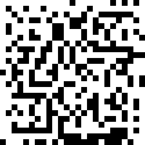
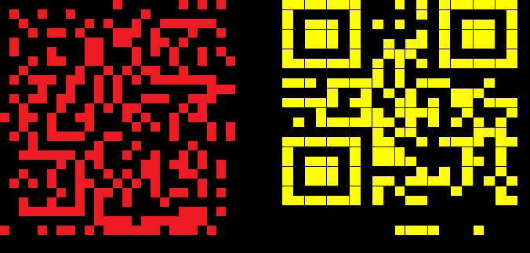

#### Uppdrag
### Gammal matlåda

Efter ett tag hittar VD:n sin strumpa och börjar lugna ner sig. Men just innan
blodtrycket har sjunkit till en nästan hälsosam nivå upptäcks nästa katastrof.

– NEJ, NEJ, NEJ! Jag glömde matlådan kvar på skrivbordet över natten, och nu
kryllar den av **_liv_** ! Min goda Flygande **_Conway_**, lagad efter mormors bästa recept.
Kolla! Helt förstörd!

Du böjer dig tveksamt över matlådan, ännu mer tveksamt än över tvätten, och
tittar efter. Du ser hur det kryllar av **_liv_** !

---

### Solution

Conways Game of Life; let the cells evolve 2 generations to obtain the QR code.

Flag: `OP{th3_g4me}`