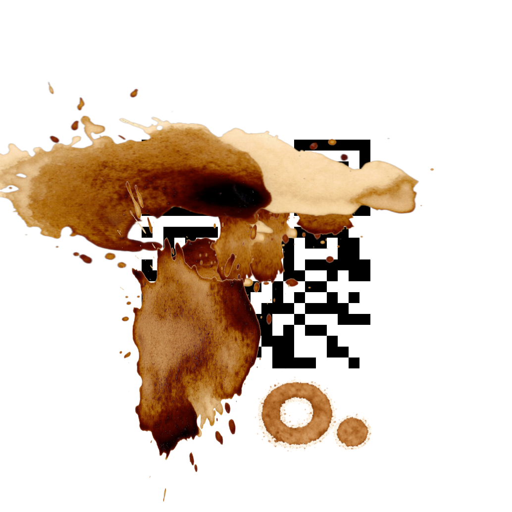
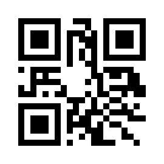

#### Uppdrag

### Spillt kaffe

Ja, det där livet var minst sagt intelligent.

– Vad var det du ville nu?

Du berättar att det har skett en incident.

– Va?! Incident?!

– Jaja, det är sånt som händer.

– Är du bussig och räcker mig det där pappret där borta? På det har jag
insider-information om vem som vinner dagens trav.

Det som VD:n pekar på ser mer ut som ett kaffefilter än ett papper.

– Ja just det, det var slut på kaffemuggar när jag skulle hämta dagens femte
kopp. Men som man säger, nöden har ingen lag.

Du suckar djupt och koncentrerar dig på det befläckade kodordet. Kanske går det
fortfarande att tyda.

##### Filer till uppgiften

---

### Solution

QR Code version = 1  
mask pattern = 2  
character count = 12  
encoding mode = byte  
error correction = level M  
data bits = 108

Flag: `OP{Kafferep}`