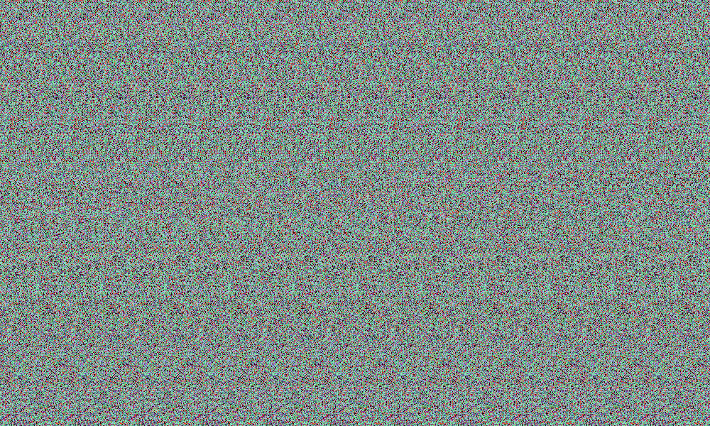

#### Uppdrag
### Abracadabra

När du tittar upp från mobilen är hunden borta. I stället fastnar blicken på
väggen där den satt. Där hänger en stor tavla.

Har den… alltid hängt där?

En obehaglig nyfikenhet drar i dig. Du går närmare och undersöker tavlan, som om
den kallar på dig.

##### Filer till uppgiften

---

### Solution

Autostereogram (Magic Eye); compute a disparity map.  
The image is a Magic Eye autostereogram with a pattern period of 90 px. I
matched each pixel against the same row shifted by 60–95 px and plotted the best
shift as a depth map. The hidden text sits at a shift of 72, against 90 for the
background.

Flag: `OP{HOUDINI}`