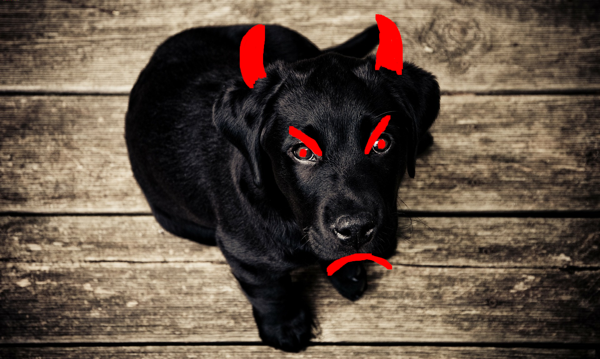

#### Uppdrag

### Bitvarg

Plötsligt flammar rummet upp i stark belysning. Någon måste ha tänt lampan.

Du tittar dig snabbt omkring, men ser ingen.

I stället är det något annat som fångar din uppmärksamhet: mitt på golvet sitter
en hund. När du tittar närmare ser du att det är samma hund som vaktade tavlan.

Hunden skäller till:
– Hörru du!

– Det är jag som är hunden… fast nu är jag ond!

Den tar ett steg fram, blicken glimmar illmarigt.
– För att få komma ut igen måste du ge mig kodordet.

Den flinar, på det där sättet som bara hundar kan.
– Att leta i de minst signifikanta bitarna var ju rena valpleken.
– Du kommer aldrig kunna gissa var jag gömt flaggan den här gången.

##### Filer till uppgiften

---

### Solution

This time the data is in the most significant bit (bit 7) of the R, G and B
channels, not the least significant bits the dog mentions. I read that bit plane
in order, 8 bits per byte, MSB first. The text is at the very start of the
stream, followed by a newline and then nothing but zero bytes.

Flag: `OP{ImTheHiddenKing}`