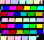

#### Uppdrag

### Konstig kod

När du tittar närmare på hönshusen upptäcker du att det sitter en affisch på
vart och ett av dem. De är pyttesmå, precis lagom stora för att en höna ska
kunna läsa dem.

Affischerna föreställer något abstrakt mönster, klossar i klara färger som inte
verkar betyda något. Ändå kan du inte släppa känslan av att mönstret följer en
logik. Nästan som om någon skrivit dem, inte målat dem.

##### Filer till uppgiften

---

### Solution

The poster is a program in Piet, an esoteric language written as coloured
blocks. I wrote a quick Piet interpreter and ran it with one pixel per codel. It
printed the flag directly.

Flag: `OP{code_can_be_art_and_art_can_be_code}`